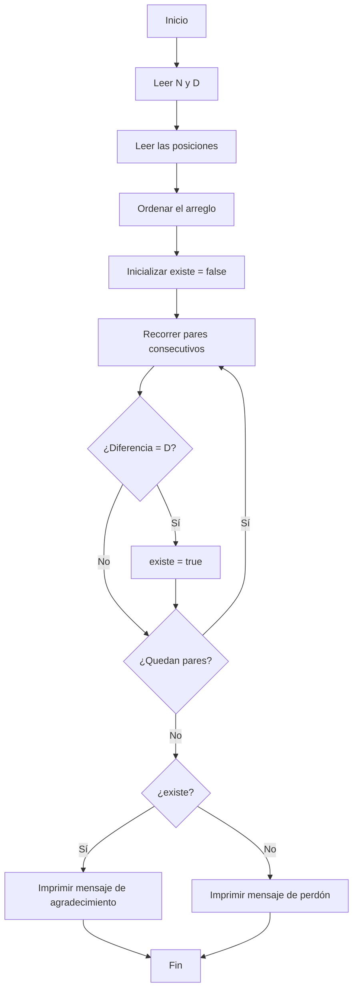

# C22O25. Gracias Jason Funderburker

**Autor:** wisperfrog

**Link:** [Gracias Jason Funderburker](https://www.cpcjudge.com/problem/graciasjasonfunder)

**Tiempo límite:** 0.5s

**Memoria límite:** 256M

## Descripción

Es Halloween y tú, junto con Jason Funderburker, están adornando las calles. Jason Funderburker coloca tumbas y tú arañas, pero te diste cuenta de que Jason Funderburker las coloca en distancias diferentes y quieres ayudarlo. Para que la decoración se vea linda, quieres que las tumbas estén a una distancia  **EXACTA** de **$D$** entre sí, pero Jason Funderburker es muy terco (ni habla) y le cuesta colocarlas de forma correcta. Ya estás harto, así que te basta con que un solo par de tumbas ***consecutivas*** tengan una distancia  **EXACTA** de **$D$** entre sí.

Jason Funderburker ya ha colocado $N$ tumbas, cada una en una posición **$P_i$**. Tu misión es saber si Jason Funderburker cumplió lo estipulado o no.

## Entrada

En la primera línea dos enteros $N$ $(1 \leq N \leq 10^5)$ y $D$ $(1 \leq D \leq 10^5)$, la cantidad de tumbas que colocó Jason Funderburker y la distancia, respectivamente.

En la segunda línea $N$ enteros $P_1, P_2, ..., P_N$, donde $P_i$ $(1 \leq P_i \leq 10^9)$ indica la posición donde Jason Funderburker colocó la $i$- $ésima$ tumba.

No puede haber dos tumbas en la misma posición.

## Salida
Si Jason Funderburker cumplió lo estipulado, imprimir "Querido Dios, no tengo suficientes palabras para expresar lo mucho que estoy agradecido al mundo por la existencia de Jason Funderburker.".

En caso contrario, imprimir "Te perdono, Jason Funderburker.".

## Ejemplos

### Ejemplo 1

#### Entrada

```text
7 10
10 50 1 5 21 22 11
```

#### Salida

```text
Querido Dios, no tengo suficientes palabras para expresar lo mucho que estoy agradecido al mundo por la existencia de Jason Funderburker.
```
### Ejemplo 2

#### Entrada

```text
7 10
10 50 1 5 23 22 11
```

#### Salida

```text
Querido Dios, no tengo suficientes palabras para expresar lo mucho que estoy agradecido al mundo por la existencia de Jason Funderburker.
```


## Notas

En el primer ejemplo, las tumbas tienen las siguientes posiciones:
$1$, $5$, $10$, $11$, $,21$, $22$, $50$. El par de tumbas consecutivas que tiene una distancia $10$ es el par {$11, 21$} $\rightarrow$ $21 - 11 = 10$.

En el segundo ejemplo, las tumbas tienen las siguientes posiciones:
$1$, $5$, $10$, $11$, $22$, $23$, $50$. Ningún par de tumbas consecutivas tiene una distancia de $10$.

## Temas identificados

### Programación

- Ordenamiento de arreglos.
- Recorrido secuencial.
- Búsqueda por comparación de elementos consecutivos.
- Uso de variables booleanas.

### Matemáticas

- Diferencia entre dos números.

## Propuesta de solución

**Autor de la propuesta:** mae

El problema consiste en determinar si existe al menos un par de tumbas consecutivas cuya distancia sea exactamente $D$. Como las posiciones se reciben en un orden arbitrario, primero se almacenan en un arreglo y se ordenan de menor a mayor. Después se recorre el arreglo comparando cada posición con la anterior y calculando la diferencia entre ambas. Si alguna diferencia es igual a $D$, significa que existe un par de tumbas consecutivas que cumple la condición. En ese caso, se indica que Jason Funderburker cumplió lo estipulado. Si ninguna diferencia coincide con $D$, se imprime el mensaje correspondiente a que no cumplió.

## Observaciones

- Las posiciones se reciben desordenadas, por lo que es necesario ordenarlas de menor a mayor.
- Solo se necesita encontrar un par de tumbas consecutivas cuya diferencia sea exactamente $D$.
- Si se encuentra un par que cumple la condición, no es necesario que los demás también la cumplan.

## Restricciones

- $1 \leq N \leq 10^5$: se utiliza un arreglo de tamaño 100005 para almacenar las posiciones.
- $1 \leq P_i \leq 10^9$: se utiliza el tipo de dato int, ya que los valores están dentro de su rango.
- El ordenamiento requiere $O(N\log N)$ tiempo y el recorrido del arreglo $O(N)$, por lo que el algoritmo es eficiente para los límites establecidos.

## Estados o estructura de la solución

La solución utiliza las siguientes variables y estructuras:

- tumbas[100005]: arreglo que almacena las posiciones de las $N$ tumbas.
- n: cantidad de tumbas colocadas.
- d: distancia exacta que debe existir entre un par de tumbas consecutivas.
- existe: variable booleana que indica si se ha encontrado un par de tumbas consecutivas cuya diferencia es igual a $D$. Inicialmente toma el valor false.
- a: variable auxiliar que almacena la diferencia entre dos posiciones consecutivas del arreglo ordenado.

## Casos base

Para una sola tumba $(N=1)$: no existe ningún par de tumbas consecutivas, por lo que no es posible cumplir la condición, y se imprime Te perdono, Jason Funderburker.


Dos o más tumbas: se ordenan las posiciones y se comparan las diferencias entre elementos consecutivos. Si alguna diferencia es igual a $D$, se considera que la condición se cumple.


No se encuentra ninguna diferencia igual a $D\): la variable existe permanece en false y se imprime el mensaje correspondiente a que Jason no cumplió.

## Transiciones o algoritmo

- Leer los valores de $N$ y $D$.
- Leer las $N$ posiciones y almacenarlas en el arreglo tumbas.
- Ordenar el arreglo de menor a mayor mediante **sort(tumbas, tumbas + n)**.
- Inicializar la variable booleana existe con el valor false.
- Recorrer el arreglo desde la segunda posición hasta la última.
- En cada iteración, calcular la diferencia entre la posición actual y la anterior: tumbas[i] - tumbas[i - 1].
- Si la diferencia es igual a \(D\), asignar true a la variable existe.
- Al finalizar el recorrido, si existe es true, imprimir el mensaje de agradecimiento a Jason Funderburker. En caso contrario, imprimir el mensaje de perdón.



## Correctitud

Al ordenar las posiciones de menor a mayor, las tumbas consecutivas quedan ubicadas una junto a otra en el arreglo. Después, se calcula la diferencia entre cada posición y la anterior. Si alguna diferencia es igual a $D$, se determina que Jason cumplió lo estipulado. Si ninguna coincide, se concluye que no existe un par de tumbas consecutivas que cumpla la condición y se imprime el mensaje correspondiente.

## Complejidad computacional

- Tiempo: $O(N\log N)$
- Memoria: $O(N)$

## Implementación

### C++

**Autor de la implementación:** mae

```cpp
#include <bits/stdc++.h>

using namespace std;

int tumbas[100005];

int main()
{
    cin.tie(0); ios::sync_with_stdio(false);

    int n, d;

    cin >> n >> d;

    for (int i = 0; i < n; i++){
        cin >> tumbas[i];
    }

    sort(tumbas, tumbas + n);

    bool existe = false;

    for (int i = 1; i < n; i++){
        // cout << tumbas[i] << " ";
        int a = tumbas[i] - tumbas[i - 1];

        if (a == d){
            existe = true;
        }
    }

    if (existe) {
        cout << "Querido Dios, no tengo suficientes palabras para expresar lo mucho que estoy agradecido al mundo por la existencia de Jason Funderburker.";
    } else {
        cout << "Te perdono, Jason Funderburker.";
    }
    
    return 0;
}
```

## Casos límite

- Una sola tumba: no existe ningún par para comparar, por lo que se imprime el mensaje de perdón.
- Dos tumbas con distancia exacta $D$: se imprime el mensaje de agradecimiento.
- Ningún par cumple la distancia requerida: se imprime el mensaje de perdón.
- Posiciones cercanas al límite máximo $(10^9)$: los valores caben en el tipo de dato int.
