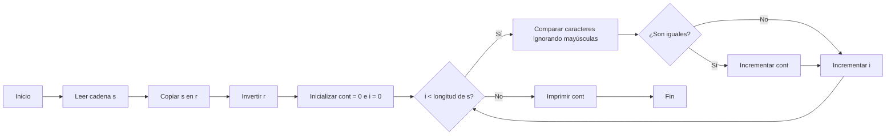

# [D25O25]. [Coincidencias de otoño
]

**Autor:** ash_c4t

**Link:** [D25O25. Coincidencias de otoño
](https://cpcjudge.com/problem/coincidencias)

**Tiempo límite:** 1.0s

**Memoria límite:** 256M

## Descripción

Ya es otoño, e Iván y su gatito naranja quieren viajar a Snoqualmie para admirar los árboles con hojas amarillas y naranjas. El viaje en tren es largo, así que para entretenerse inventan un juego: contar cuántas letras coinciden entre una palabra y su versión al revés. Ayuda a Iván y su gatito naranja.

Sea $S$ una cadena y $R$ su reverso. Nos interesa contar cuántas coincidencias hay entre $S$ y $R$.

Por ejemplo, si $S = ferrocarril$, entonces $R = lirracorref$ y hay cinco coincidencias (la primera $r$, la segunda $r$, la $c$, la tercera $r$ y la cuarta $r$).  Una coincidencia es válida **sin importar si un carácter aparece en mayúscula o en minúscula**.

Por ejemplo, si $S = fERRocArril$, entonces $R = lirrAcoRREf$ y siguen habiendo cinco coincidencias.

## Entrada

Una cadena $S$ $(1 \leq |S| \leq 1000)$, conformada únicamente por letras.

## Salida

Un entero que sea la cantidad de coincidencias entre $S$ y $R$.

## Ejemplos

### Ejemplo 1

#### Entrada

```text
fERRocArril
```

#### Salida

```text
5
```

## Notas

- $S = fERRocArril$
- $R = lirrAcoRREf$

Las cinco coincidencias son: $R$ con $r$, $R$ con $r$, $c$ con $c$, $r$ con $R$ y $r$ con $R$.

## Temas identificados

### Programación

- Recorrido de cadenas.
- Inversión de cadenas.
- Comparación de caracteres.
- Conversión de mayúsculas y minúsculas.


## Propuesta de solución

**Autor de la propuesta:** mae

Primero se crea una copia de (S) y se invierte su orden para obtener (R). Después, se recorren ambas cadenas simultáneamente, comparando los caracteres que se encuentran en la misma posición. Para que la comparación no distinga entre mayúsculas y minúsculas, se convierten ambos caracteres a minúsculas antes de compararlos.

Cada vez que los caracteres son iguales, se incrementa un contador. Al finalizar el recorrido, el contador contiene la cantidad total de coincidencias y se imprime como resultado.

## Observaciones

- Las coincidencias se cuentan comparando caracteres en la misma posición de la cadena original y su reverso.
- La comparación no distingue entre letras mayúsculas y minúsculas.
- Cada posición se evalúa una sola vez.
- No es necesario almacenar las posiciones coincidentes, ya que únicamente se solicita su cantidad.

## Restricciones
La longitud de la cadena está entre 1 y 1000 caracteres. Por lo tanto, es suficiente recorrer la cadena una sola vez para realizar todas las comparaciones.

Se utilizan dos cadenas de tipo string, una para almacenar la entrada y otra para guardar su reverso. También se emplea un contador entero para registrar las coincidencias.

## Estados o estructura de la solución

La solución utiliza las siguientes variables:

- s: almacena la cadena original ingresada.
- r: almacena una copia de s invertida mediante la función reverse.
- cont: contador entero que registra la cantidad de coincidencias encontradas.
- i: índice utilizado para recorrer las posiciones de ambas cadenas.

## Casos base

- Cadena de longitud 1: el reverso es idéntico a la cadena original, por lo que existe exactamente una coincidencia.
- Primera posición: se comienza comparando los caracteres ubicados en el índice 0. El contador inicia en 0, ya que todavía no se ha encontrado ninguna coincidencia.
- Fin del recorrido: cuando se han evaluado todas las posiciones, el algoritmo termina y devuelve el contador acumulado.

## Transiciones o algoritmo

- Leer la cadena s.
- Crear la cadena r como una copia de s.
- Invertir r utilizando reverse(r.begin(), r.end()).
- Inicializar el contador cont en 0.
- Recorrer las posiciones de la cadena desde el índice 0 hasta el último carácter.
- Convertir los caracteres de ambas cadenas a minúsculas y compararlos.
- Si los caracteres son iguales, incrementar cont en uno.
- Al terminar el recorrido, imprimir cont.



## Correctitud

El algoritmo invierte la cadena original y compara cada carácter con el de la misma posición en el reverso, ignorando las diferencias entre mayúsculas y minúsculas. Cada vez que encuentra una coincidencia, incrementa el contador. Como todas las posiciones se revisan exactamente una vez, al finalizar el recorrido el contador contiene el número total de coincidencias.

## Complejidad computacional

- Tiempo: $O(N)$
- Memoria: $O(N)$

## Implementación

### C++

**Autor de la implementación:** mae
```cpp
#include <bits/stdc++.h>

using namespace std;

int main()
{
    cin.tie(0); ios::sync_with_stdio(false);

    string s;
    cin >> s;

    string r = s;
    reverse (r.begin(), r.end());

    int cont = 0;

    for (int i = 0; i < s.length(); i++){
        if (tolower(s[i]) == tolower(r[i])){
            cont++;
        }
    }
    cout << cont;

}
```

## Casos límite

- Un carácter: salida 1.
- Sin coincidencias: salida 0.
- Mayúsculas y minúsculas: La comparación no distingue entre letras mayúsculas y minúsculas.
- Longitud máxima: una cadena de 1000 caracteres, para verificar que se respetan las restricciones.
