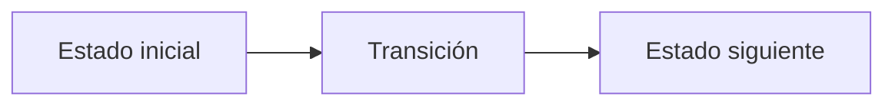

# A. Suma de A + B

**Autor:** contla_cpp

**Link:** [Suma de A + B](https://cpcjudge.com/problem/amasb)

**Tiempo límite:** 1 s

**Memoria límite:** 256 MB

## Descripción

Como todo buen programador inicia, hoy harás uno de los ejercicios más básicos de la programación: sumar dos números.

Dados dos números, muestra su suma.

## Entrada

En la primera línea se proporcionan dos números: $A$ y $B$, donde $1 \leq A, B \leq 10^5$.

## Salida

Imprime un número que represente la suma de $A + B$.

## Ejemplos

### Ejemplo 1

#### Entrada

```text
4 5
```

#### Salida

```text
9
```

### Ejemplo 2

#### Entrada

```text
5 10
```

#### Salida

```text
15
```

## Notas

En el primer ejemplo, $4 + 5 = 9$.

## Temas identificados

### Programación

- [Técnica o algoritmo]

### Matemáticas

- [Concepto matemático, si aplica]

## Propuesta de solución

**Autor de la propuesta:** [Autor de la propuesta]

Explica cómo modelar el problema y por qué la estrategia funciona.

## Observaciones

- [Observación clave del problema]

## Restricciones

[Relaciona los límites de entrada con la complejidad necesaria y justifica las
estructuras de datos elegidas.]

## Estados o estructura de la solución

[Define los estados, variables o estructuras principales. Si es programación
dinámica, explica qué representa cada estado y sus transiciones.]


## Casos base

[Indica los casos base y explica por qué son correctos.]

## Transiciones o algoritmo

[Explica paso a paso la transición entre estados o el algoritmo general.]



## Correctitud

[Argumenta por qué el algoritmo genera todas las soluciones válidas y no
cuenta ninguna solución más de una vez.]

## Complejidad computacional

- Tiempo: $O(?)$
- Memoria: $O(?)$

## Implementación

### C++

**Autor de la implementación:** [Autor de la implementación]

```cpp
// Código de la solución.
```

## Casos límite

- [Caso límite y resultado esperado]
- [Caso límite relacionado con las restricciones]
