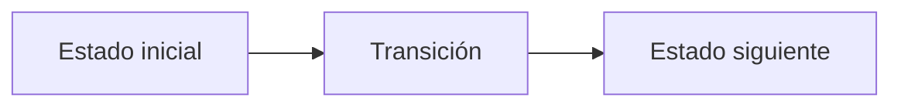

# B. Lo sé, nada es fácil

**Autor:** Kaarlarax

**Link:** [Lo sé, nada es fácil](https://cpcjudge.com/problem/nadaesfacil)

**Tiempo límite:** 1 s

**Memoria límite:** 256 MB

## Descripción

Ashley es una pequeña garza que disfruta contemplar los atardeceres. Conoce la hora exacta en que se ocultará el sol, pero necesita saber cuánto tiempo falta para que llegue ese momento.

Dada la hora del atardecer y la hora actual, determina cuántas horas faltan para que Ashley pueda contemplarlo nuevamente.

## Entrada

La única línea contiene dos números enteros $A$ y $H$, separados por un espacio, que representan la hora del atardecer y la hora actual, respectivamente.

Se cumplen las siguientes restricciones:

- $0 \leq H \leq A \leq 23$.
- Las horas se representan en formato de 24 horas.
- Ambas horas pertenecen al mismo día.

## Salida

Imprime un único número entero que represente la cantidad de horas que faltan para el atardecer.

## Ejemplos

### Ejemplo 1

#### Entrada

```text
19 14
```

#### Salida

```text
5
```

### Ejemplo 2

#### Entrada

```text
18 18
```

#### Salida

```text
0
```

## Notas

En el primer ejemplo, el atardecer ocurre a las 19 horas y la hora actual es 14, por lo que faltan $19 - 14 = 5$ horas.

En el segundo ejemplo, el atardecer ya ha llegado, pues ambas horas son iguales, por lo que faltan $18 - 18 = 0$ horas.

## Temas identificados

### Programación

- [Técnica o algoritmo]

### Matemáticas

- [Concepto matemático, si aplica]

## Propuesta de solución

**Autor de la propuesta:** [Autor de la propuesta]

Explica cómo modelar el problema y por qué la estrategia funciona.

## Observaciones

- [Observación clave del problema]

## Restricciones

[Relaciona los límites de entrada con la complejidad necesaria y justifica las
estructuras de datos elegidas.]

## Estados o estructura de la solución

[Define los estados, variables o estructuras principales. Si es programación
dinámica, explica qué representa cada estado y sus transiciones.]


## Casos base

[Indica los casos base y explica por qué son correctos.]

## Transiciones o algoritmo

[Explica paso a paso la transición entre estados o el algoritmo general.]



## Correctitud

[Argumenta por qué el algoritmo genera todas las soluciones válidas y no
cuenta ninguna solución más de una vez.]

## Complejidad computacional

- Tiempo: $O(?)$
- Memoria: $O(?)$

## Implementación

### C++

**Autor de la implementación:** [Autor de la implementación]

```cpp
// Código de la solución.
```

## Casos límite

- [Caso límite y resultado esperado]
- [Caso límite relacionado con las restricciones]
