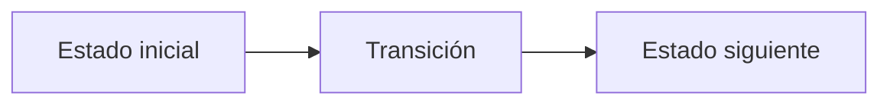

**# C. ¿Qué haremos el día de hoy?**

**Autor:** Kaarlarax

**Link:** [¿Qué haremos el día de hoy?](https://cpcjudge.com/problem/queharemoshoy)

**Tiempo límite:** 1 s

**Memoria límite:** 256 MB

## Descripción

Sandro y Melissa son dos garzas de agua que disfrutan pasar tiempo juntos. Dependiendo de la hora a la que se encuentren, tienen planeada una actividad diferente.

Si se encuentran a las 15:00 horas, pasarán la tarde jugando videojuegos y disfrutando de una cena. Si se encuentran a las 17:00 horas, contemplarán el firmamento.

Dada la hora en que se encontrarán, determina qué actividad realizarán juntos.

## Entrada

La única línea contiene un número entero $H$, que representa la hora en que Sandro y Melissa se encontrarán, utilizando el formato de 24 horas.

Se garantiza que $H$ será $15$ o $17$.

## Salida

Imprime una única línea de acuerdo con la hora indicada:

- Si $H = 15$, imprime `Videojuegos y amigos :)`.
- Si $H = 17$, imprime `Una vista increible`.

La salida debe coincidir exactamente con el texto indicado.

## Ejemplos

### Ejemplo 1

#### Entrada

```text
15
```

#### Salida

```text
Videojuegos y amigos :)
```

### Ejemplo 2

#### Entrada

```text
17
```

#### Salida

```text
Una vista increible
```

## Notas

En el primer ejemplo, Sandro y Melissa se encontrarán a las 15:00 horas, así que disfrutarán de una tarde de videojuegos.

En el segundo ejemplo, se encontrarán a las 17:00 horas, por lo que pasarán tiempo contemplando el cielo.

## Temas identificados

### Programación

- [Técnica o algoritmo]

### Matemáticas

- [Concepto matemático, si aplica]

## Propuesta de solución

**Autor de la propuesta:** [Autor de la propuesta]

Explica cómo modelar el problema y por qué la estrategia funciona.

## Observaciones

- [Observación clave del problema]

## Restricciones

[Relaciona los límites de entrada con la complejidad necesaria y justifica las
estructuras de datos elegidas.]

## Estados o estructura de la solución

[Define los estados, variables o estructuras principales. Si es programación
dinámica, explica qué representa cada estado y sus transiciones.]


## Casos base

[Indica los casos base y explica por qué son correctos.]

## Transiciones o algoritmo

[Explica paso a paso la transición entre estados o el algoritmo general.]



## Correctitud

[Argumenta por qué el algoritmo genera todas las soluciones válidas y no
cuenta ninguna solución más de una vez.]

## Complejidad computacional

- Tiempo: $O(?)$
- Memoria: $O(?)$

## Implementación

### C++

**Autor de la implementación:** [Autor de la implementación]

```cpp
// Código de la solución.
```

## Casos límite

- [Caso límite y resultado esperado]
- [Caso límite relacionado con las restricciones]
