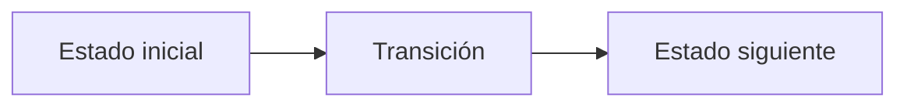

# D. Par o Impar

**Autor:** Tourist

**Link:** [Par o Impar](https://cpcjudge.com/problem/paroimpar)

**Tiempo límite:** 0.5 s

**Memoria límite:** 32 MB

## Descripción

En la fila de un establecimiento se enumeraron a los comensales.

Los que tengan números impares formarán una fila del lado izquierdo, y los que tengan número par estarán del lado derecho.

Se diseña un código que introduzca el número $N$ y determine si es número par o impar.

## Entrada

Recibirás un número entero $N$.

Se cumple la siguiente restricción:

- $1 \leq N \leq 10^9$.

## Salida

Deberás mostrar, en caso de que $N$ sea par, `Par`; en caso contrario, `Impar`.

## Ejemplos

### Ejemplo 1

#### Entrada
```text
8
```

#### Salida
```text
Par
```

### Ejemplo 2

#### Entrada
```text
5
```

#### Salida
```text
Impar
```

### Ejemplo 3

#### Entrada
```text
13
```

#### Salida
```text
Impar
```

## Notas

El enunciado no incluye notas adicionales para los ejemplos.

## Temas identificados

### Programación

- [Técnica o algoritmo]

### Matemáticas

- [Concepto matemático, si aplica]

## Propuesta de solución

**Autor de la propuesta:** [Autor de la propuesta]

Explica cómo modelar el problema y por qué la estrategia funciona.

## Observaciones

- [Observación clave del problema]

## Restricciones

[Relaciona los límites de entrada con la complejidad necesaria y justifica las
estructuras de datos elegidas.]

## Estados o estructura de la solución

[Define los estados, variables o estructuras principales. Si es programación
dinámica, explica qué representa cada estado y sus transiciones.]


## Casos base

[Indica los casos base y explica por qué son correctos.]

## Transiciones o algoritmo

[Explica paso a paso la transición entre estados o el algoritmo general.]



## Correctitud

[Argumenta por qué el algoritmo genera todas las soluciones válidas y no
cuenta ninguna solución más de una vez.]

## Complejidad computacional

- Tiempo: $O(?)$
- Memoria: $O(?)$

## Implementación

### C++

**Autor de la implementación:** [Autor de la implementación]

```cpp
// Código de la solución.
```

## Casos límite

- [Caso límite y resultado esperado]
- [Caso límite relacionado con las restricciones]
