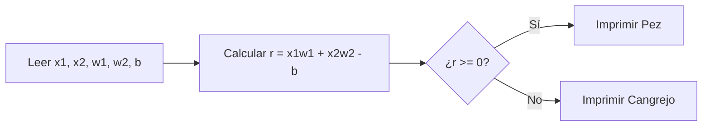

# E. Zacarias Garcia

**Autor:** Jordan

**Link:** [Zacarias Garcia](https://cpcjudge.com/problem/zacariasgarciaeasy)

**Tiempo límite:** 1 s

**Memoria límite:** 256 MB

## Descripción

Las garzas de agua son aves pacientes, capaces de pasar horas observando la superficie del río en busca de alimento. Sin embargo, Zacarías García tiene gustos bastante particulares: le encantan los peces, pero los cangrejos le parecen demasiado problemáticos por sus pequeñas pinzas. El problema es que, cuando observa algo moviéndose desde la distancia, ¡no siempre puede distinguir de qué animal se trata!

Para resolver este inconveniente, Zacarías necesita un pequeño perceptrón que clasifique a los animales según su longitud y peso. A partir de la observación, puede estimar la longitud $x_1$ en metros y el peso $x_2$ en kilogramos. Cada característica tiene asociado un peso que determina su influencia en la decisión. También se utiliza un sesgo $b$ para ajustar el criterio de clasificación.

El perceptrón calcula primero una suma ponderada mediante:

$$
r=x_1w_1+x_2w_2-b
$$

Después, se aplica una función de activación escalón:

$$
f(r)=
\begin{cases}
1 & \text{si } r\geq 0\\
0 & \text{si } r<0
\end{cases}
$$

Si el resultado es $1$, el animal se clasifica como **Pez**. Si el resultado es $0$, se clasifica como **Cangrejo**.

## Entrada

La única línea contiene cinco números reales $x_1$, $x_2$, $w_1$, $w_2$ y $b$, separados por espacios, que representan:

- $x_1$: la longitud en metros del animal observado.
- $x_2$: el peso en kilogramos del animal observado.
- $w_1$: el peso asociado a la longitud.
- $w_2$: el peso asociado al peso del animal.
- $b$: el sesgo del perceptrón.

Se cumple que:

$$
-100\leq x_1,x_2,w_1,w_2,b\leq100
$$

Los valores pueden contener decimales.

## Salida

Imprime una única línea con la clasificación realizada por el perceptrón:

- Si $r\geq0$, imprime `Pez`.
- Si $r<0$, imprime `Cangrejo`.

La salida debe coincidir exactamente con el texto indicado.

## Ejemplos

### Ejemplo 1

#### Entrada

```text
8.0 2.0 1.5 -0.5 -5.0
```

#### Salida

```text
Pez
```

### Ejemplo 2

#### Entrada

```text
3.0 6.0 1.0 -0.5 -2.0
```

#### Salida

```text
Cangrejo
```

## Notas

En el primer ejemplo, el valor calculado es:

$$
r=(8.0)(1.5)+(2.0)(-0.5)-(-5.0)=17
$$

Como $17\geq0$, el perceptrón clasifica al animal como `Pez`.

En el segundo ejemplo:

$$
r=(3.0)(1.0)+(6.0)(-0.5)-(-2.0)=-2
$$

Como $-2<0$, la clasificación es `Cangrejo`.

## Temas identificados

### Programación

- Condicionales if/else.
- Operaciones con números reales.
- Implementación de un perceptrón simple.

### Matemáticas

- Suma ponderada.
- Función de activación escalón.
- Clasificación binaria.

## Propuesta de solución

**Autor de la propuesta:** Jordan

El problema puede modelarse directamente como un perceptrón de una sola capa. Se reciben dos características, $x_1$ y $x_2$, junto con sus respectivos pesos $w_1$ y $w_2$, y un sesgo $b$.

Primero se calcula el valor:

$$
r=x_1w_1+x_2w_2-b
$$

Posteriormente, se compara $r$ con cero. Si el resultado es mayor o igual a cero, se obtiene la clase `Pez`; en caso contrario, se obtiene la clase `Cangrejo`.

No es necesario utilizar estructuras de datos, ciclos ni algoritmos de búsqueda, ya que únicamente se realiza un cálculo con los cinco valores proporcionados.

## Observaciones

- La clasificación depende únicamente del signo del valor $r$.
- Si $r=0$, el resultado corresponde a `Pez`.
- Los valores de entrada pueden ser números reales, por lo que se utilizan variables de tipo `double`.

## Restricciones

Los cinco valores están acotados entre $-100$ y $100$, por lo que basta con realizar una cantidad constante de operaciones aritméticas.

Debido a que solamente existe una instancia del problema y no hay estructuras de datos que almacenar, la solución requiere memoria constante.

## Transiciones o algoritmo

1. Leer $x_1$, $x_2$, $w_1$, $w_2$ y $b$.
2. Calcular la suma ponderada $r=x_1w_1+x_2w_2-b$.
3. Verificar si $r\geq0$.
4. Si la condición se cumple, imprimir `Pez`.
5. En caso contrario, imprimir `Cangrejo`.



## Correctitud

El algoritmo calcula exactamente el valor $r$ utilizado por el perceptrón. La función de activación divide los posibles resultados en dos casos: cuando $r\geq0$, la clasificación es `Pez`, y cuando $r<0$, la clasificación es `Cangrejo`.

Por lo tanto, cada posible entrada produce exactamente una de las dos clasificaciones establecidas por el problema.

## Complejidad computacional

- Tiempo: $O(1)$
- Memoria: $O(1)$

## Implementación

### C++

**Autor de la implementación:** Jordan

```cpp
#include <bits/stdc++.h>

using namespace std;

int main() {
    cin.tie(0); ios::sync_with_stdio(0);

    double x1, x2, w1, w2, b;

    cin >> x1 >> x2 >> w1 >> w2 >> b;
    
    double r = x1 * w1 + x2 * w2 - b;

    if (r >= 0){
        cout << "Pez" << '\n';
    } else {
        cout << "Cangrejo" << '\n';
    }
    
    return 0;
}
```