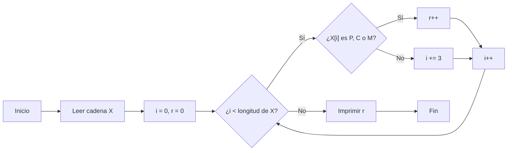

# F. Alimentación cotidiana

**Autor:** ElPedrangas03

**Link:** [Alimentación cotidiana](https://cpcjudge.com/problem/alimentacioncotidia)

**Tiempo límite:** 1.0 s

**Memoria límite:** 128M

## Descripción

Durante sus vacaciones en Veracruz, Carlos observó a varias garzas buscando alimento. Estas pueden alimentarse de distintas presas, pero una garza en particular únicamente puede comer peces **(P)**, crustáceos **(C)** y moluscos **(M)**.

Si encuentra cualquier otra presa, la garza ignora esa presa y también las siguientes tres presas que encuentre. Después de ignorarlas, vuelve a seleccionar su alimento normalmente.

Dada la cadena de presas registradas durante el recorrido, determina cuántas presas logró comer la garza.

## Entrada

La entrada consta de una cadena de texto $X$, que representa las presas encontradas por la garza durante su recorrido, en el orden en que aparecen.

## Salida

Imprime un entero que represente la cantidad de presas que logró comer la garza.

## Ejemplos

### Ejemplo 1

#### Entrada

```text
PRACMPRACM
```

#### Salida

```text
2
```

### Ejemplo 2

#### Entrada

```text
PAPAPAPAPA
```

#### Salida

```text
1
```

## Notas

La garza puede comer únicamente:

- **P**: Pez
- **C**: Crustáceo
- **M**: Molusco

Cuando encuentra **R** o **A**, ignora esa presa y las **tres siguientes**, por lo que se deben avanzar cuatro posiciones en total desde la presa que provocó el comportamiento.

Por ejemplo, en **PRACM**, la **P** puede ser comida. Al encontrar **R**, se ignoran **R**, **A**, **C** y **M**, por lo que solamente se cuenta una presa.

## Temas identificados

### Programación

- Recorrido de cadenas.
- Condicionales.
- Manipulación de índices.
- Simulación.

## Propuesta de solución

**Autor de la propuesta:** Jordan

Se puede recorrer la cadena utilizando un índice $i$.

En cada posición existen dos posibilidades:

1. Si el carácter es **P**, **C** o **M**, la garza puede comerlo, por lo que se incrementa el contador.
2. Si el carácter es **R** o **A**, la garza no puede comerlo y debe ignorar también las siguientes tres presas. Por lo tanto, se incrementa el índice en **3** adicionalmente.

Después de cada iteración, el ciclo incrementa el índice una posición normalmente.

## Observaciones

- Las únicas presas que se cuentan son **P**, **C** y **M**.
- Encontrar **R** o **A** provoca que se salten las tres posiciones siguientes.
- Si quedan menos de tres presas después de una presa ignorada, simplemente se avanza hasta terminar la cadena.
- No es necesario modificar la cadena original.

## Restricciones

- $1 \leq |X| \leq 100$
- $X$ únicamente contiene los caracteres **P**, **R**, **A**, **C** y **M**.

## Transiciones o algoritmo

1. Leer la cadena $S$.
2. Inicializar `r = 0`.
3. Recorrer la cadena mediante $i$.
4. Si `X[i]` es **P**, **C** o **M**, incrementar $r$.
5. En caso contrario, incrementar $i$ en $3$ posiciones adicionales para ignorar las siguientes tres presas.
6. Al terminar el recorrido, imprimir $r$.



## Correctitud

El algoritmo considera cada presa en el orden en que aparece.

Si encuentra **P**, **C** o **M**, incrementa el contador porque la garza puede alimentarse de ella.

Si encuentra **R** o **A**, no incrementa el contador y avanza tres posiciones adicionales, además del incremento normal del ciclo. Esto hace que se ignoren exactamente las tres presas siguientes, tal como establece el problema.

Por lo tanto, todas las presas que la garza puede comer son contabilizadas y todas las presas que debe ignorar son omitidas.

## Complejidad computacional

- **Tiempo:** $O(n)$, donde $n$ es la longitud de la cadena.
- **Memoria:** $O(1)$ de memoria auxiliar, sin contar la cadena de entrada.

## Implementación

### C++

**Autor de la implementación:** Jordan

```cpp
#include <bits/stdc++.h>
using namespace std;

int main()
{
    cin.tie(0); ios_base::sync_with_stdio(0);

    string s; 
    cin >> s;
    
    int r = 0;

    for (int i = 0; i < s.length(); i++) {
        if (s[i] == 'P' || s[i] == 'C' || s[i] == 'M') {
            r++;
        } else {
            i += 3;
        }
    }

    cout << r;

    return 0;
}
```

## Casos límite

- La cadena contiene únicamente presas que la garza puede comer, por ejemplo **PCMP**; todas deben contabilizarse.
- La cadena contiene únicamente presas que la garza no puede comer, por ejemplo **RARAR**; se deben aplicar los saltos correspondientes.
- Una presa no comestible aparece cerca del final de la cadena; se saltan únicamente las posiciones que existan.
- La cadena tiene longitud $1$.
- Una presa comestible aparece después de un grupo de cuatro posiciones que fueron ignoradas.