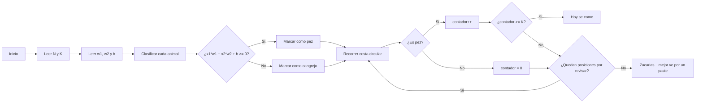

# G. Zacarias Garcia (Versión Difícil)

**Autor:** Jordan

**Link:** [Zacarias Garcia (Versión Difícil)](https://cpcjudge.com/problem/zacariasgarciahard)

**Tiempo límite:** 1.0 s

**Memoria límite:** 256M

## Descripción

Zacarías García es una garza que utiliza un perceptrón para clasificar animales según su longitud y peso. El perceptrón calcula:

$z = x_1w_1 + x_2w_2 + b$

Después aplica una función de activación escalón:

$$
f(r)=
\begin{cases}
1 & \text{si } z\geq 0\\
0 & \text{si } z<0
\end{cases}
$$

Si el resultado es $1$, el animal se clasifica como pez; si es $0$, se clasifica como cangrejo.

Los animales se encuentran alrededor de una costa circular. Zacarías necesita encontrar un tramo de al menos `K` peces consecutivos. Debido a que la costa es circular, el tramo puede comenzar cerca del final y continuar desde la primera posición.

## Entrada

La primera línea contiene dos enteros $N$ y $K$, que representan la cantidad de animales y la cantidad mínima de peces consecutivos necesarios.

La segunda línea contiene tres números reales $w_1$, $w_2$ y $b$, correspondientes a los pesos y el sesgo del perceptrón.

Las siguientes $N$ líneas contienen dos números reales $x_1$ y $x_2$, correspondientes a la longitud y peso de cada animal.

## Salida

Si existe un tramo de al menos $K$ peces consecutivos, imprime:

```text
Hoy se come
```

En caso contrario, imprime:

```text
Zacarias... mejor ve por un paste
```

La salida debe coincidir exactamente con el texto indicado.

## Ejemplos

### Ejemplo 1

#### Entrada

```text
5 3
1.0 -1.0 -2.0
4.0 1.0
5.0 1.0
1.0 4.0
3.0 1.0
4.0 2.0
```

#### Salida

```text
Hoy se come
```

### Ejemplo 2

#### Entrada

```text
5 3
1.0 -1.0 -2.0
1.0 4.0
1.0 5.0
4.0 1.0
5.0 1.0
1.0 4.0
```

#### Salida

```text
Zacarias... mejor ve por un paste
```

## Notas

Cada animal se clasifica de manera independiente mediante el perceptrón.

Para determinar si existe un grupo válido, basta con conocer si cada posición corresponde a un pez o a un cangrejo.

Como la costa es circular, después de la última posición se debe continuar nuevamente desde la primera.

## Temas identificados

### Programación
- Ciclos.
- Condicionales.
- Arreglos.
- Recorridos circulares.
- Simulación.

### Matemáticas
- Suma ponderada.
- Función de activación escalón.
- Perceptrón.

## Propuesta de solución

**Autor de la propuesta:** Jordan

La solución se puede dividir en dos etapas.

Primero se procesa cada animal utilizando el perceptrón. Si:

$x_1w_1+x_2w_2+b \geq 0$

se considera que la posición contiene un pez. En caso contrario, contiene un cangrejo.

Estas clasificaciones se almacenan en un arreglo booleano.

Después se recorre la costa buscando $K$ peces consecutivos. Como la costa es circular, cuando se llega a la posición $N$, se vuelve a la posición $0$.

Si el contador de peces consecutivos alcanza $K$, existe un lugar adecuado y se imprime "Hoy se come".

## Observaciones

- No es necesario almacenar los valores $x_1$ y $x_2$ después de clasificar cada animal.
- La fórmula utilizada es exactamente la suma ponderada del perceptrón.
- Una posición se considera pez cuando el resultado del perceptrón es mayor o igual que $0$.
- La costa debe tratarse como circular.
- Como $K \leq N$, no es necesario revisar más de una vuelta completa y una cantidad adicional suficiente para detectar una secuencia que cruce el final.

## Restricciones

- $1 \leq K \leq N \leq 2 \dot 10^5$
- $-100 \leq x_1, x_2, w_1, w_2, b \leq 100$
- Los valores reales pueden contener decimales.

## Estados o estructura de la solución

Se utiliza:

- `costa[i]`: indica si el animal de la posición $i$ fue clasificado como pez.
- `contador`: cantidad de peces consecutivos encontrados hasta la posición actual.
- `maximo`: cantidad de posiciones revisadas durante el recorrido circular.
- `encontrado`: indica si ya se encontró un tramo de al menos $K$ peces.

No se necesita una estructura de datos adicional.

## Casos base

El recorrido termina en cualquiera de los siguientes casos:

1. Se encuentran $K$ peces consecutivos.
2. Se revisa una cantidad suficiente de posiciones sin encontrar $K$ peces consecutivos.

Si se alcanza el primer caso, la respuesta es "Hoy se come"; de lo contrario, la respuesta es "Zacarias... mejor ve por un paste".

## Transiciones o algoritmo

1. Leer $N$ y $K$.
2. Leer $w_1$, $w_2$ y $b$.
3. Para cada animal:
   - Leer $x_1$ y $x_2$.
   - Calcular $r = x_1 * w_1 + x_2 * w_2 + b$.
   - Si $r >= 0$, marcar la posición como pez.
4. Inicializar el contador de peces consecutivos en $0$.
5. Recorrer las posiciones de la costa de manera circular.
6. Si la posición actual es un pez, incrementar `contador`.
7. Si es un cangrejo, reiniciar `contador` a $0$.
8. Si $contador >= K$, se encontró un tramo válido.
9. Imprimir la respuesta correspondiente.



## Correctitud

Cada animal se clasifica correctamente porque se aplica la fórmula del perceptrón y la función escalón indicada en el problema.

Posteriormente, el algoritmo recorre las posiciones clasificadas manteniendo `contador` como el número de peces consecutivos actuales. Cuando encuentra un cangrejo, el contador se reinicia porque la secuencia consecutiva se interrumpe.

El índice se reinicia en $0$ al alcanzar $N$, por lo que también se consideran secuencias que comienzan al final de la costa y continúan al principio.

Por lo tanto, si el algoritmo encuentra $K$ posiciones consecutivas clasificadas como peces, existe el tramo requerido. Si termina el recorrido sin encontrarlo, no existe un tramo que cumpla la condición.

## Complejidad computacional

- **Tiempo:** $O(N)$.
- **Memoria:** $O(N)$.

La primera parte procesa los $N$ animales y la segunda realiza un recorrido de la costa. El arreglo booleano utilizado para almacenar las clasificaciones requiere $O(N)$ memoria.

## Implementación

### C++

**Autor de la implementación:** Jordan

```cpp
#include <bits/stdc++.h>

using namespace std;

bool costa[200005];

int main() {
    cin.tie(0);
    ios::sync_with_stdio(0);

    double x1, x2, w1, w2, b;
    int n, k;

    cin >> n >> k;
    cin >> w1 >> w2 >> b;

    for (int i = 0; i < n; i++) {
        cin >> x1 >> x2;

        double r = x1 * w1 + x2 * w2 + b;

        if (r >= 0)
            costa[i] = true;
    }

    bool encontrado = false;
    int contador = 0;
    int maximo = 0;

    for (int i = 0; maximo < n + k; i++, maximo++) {
        if (i == n)
            i = 0;

        if (costa[i])
            contador++;
        else
            contador = 0;

        if (contador >= k) {
            encontrado = true;
            break;
        }
    }

    if (encontrado) {
        cout << "Hoy se come";
    } else {
        cout << "Zacarias... mejor ve por un paste";
    }

    return 0;
}
```

## Casos límite

- $N = 1$ y $K = 1$, con el único animal clasificado como pez.
- Todos los animales son clasificados como cangrejos.
- Todos los animales son clasificados como peces.
- La secuencia de $K$ peces comienza en las últimas posiciones y continúa desde la primera.
- La secuencia válida tiene exactamente $K$ peces.
- $K = N$, por lo que todos los animales deben ser peces para obtener una respuesta positiva.
- La secuencia de peces se encuentra justo al finalizar la primera vuelta de la costa.