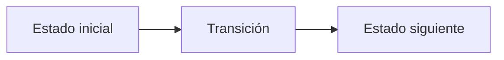

# Comida Interesante

**Autores:** Tourist, Soria

**Link:** [Comida Interesante](https://www.cpcjudge.com/problem/comidainteresante)

**Tiempo límite:** 1.0s

**Memoria límite:** 256M

## Descripción

A cierto Capibara Celestial le gusta descansar después de un duro día de trabajo, así que es común encontrarlo recostado comiendo algo. Como todo Capibara Celestial, adora las $Empanadas$, que se venden en $n$ tiendas diferentes de la ciudad. Se sabe que el precio de una $Empanada$ en la tienda $i$ es de $x_i$ monedas.

El Capibara Celestial planea comprar su comida favorita durante $q$ días consecutivos. Cada día $i$, él sabe que tendrá $m_i$ monedas disponibles. Ahora, para cada día, quiere saber ¿En cuántas tiendas distintas podrá comprar una $Empanada$

## Entrada

- La primera línea contiene un entero $n$ $(1 ≤ n ≤ 10^5)$ el número de tiendas que venden $Empanadas$.
- La segunda línea contiene n enteros $x_i$ $(1 ≤ x_i ≤ 10^9)$ los precios de la comida en cada tienda.
- La tercera línea contiene un entero $q$ $(1 ≤ q ≤ 10^5)$ el número de días que el Capibara Celestial comprará.
- Luego siguen $q$ líneas, cada una con un entero $m_i$ $(1 ≤ m_i ≤ 10^9)$ la cantidad de monedas que tiene el día $i$.

## Salida

Imprime $q$ enteros, uno por día. El $i-ésimo$ entero debe ser igual al número de tiendas donde el Capibara Celestial puede comprar una $Empanada$ en el día $i$.

## Ejemplos

### Ejemplo 1

#### Entrada

```text
5
3 10 8 6 11
4
1
10
3
11
```

#### Salida

```text
0
4
1
5
```

## Notas

- Día 1 $(m_1 = 1)$: No puede comprar en ninguna tienda (todas cuestan más de 3). $→ 0$
- Día 2 $(m_2 = 10)$: Puede comprar en las tiendas con precios $3, 6, 8, 10 → 4$
- Día 3 $(m_3 = 3)$: Solo puede en la tienda con precio $3 → 1$
- Día 4 $(m_4 = 11)$: Puede comprar en todas $3, 6, 8, 10, 11 → 5$

## Temas identificados

### Programación

- [Técnica o algoritmo]

### Matemáticas

- [Concepto matemático, si aplica]

## Propuesta de solución

**Autor de la propuesta:** [Autor de la propuesta]

Explica cómo modelar el problema y por qué la estrategia funciona.

## Observaciones

- [Observación clave del problema]

## Restricciones

[Relaciona los límites de entrada con la complejidad necesaria y justifica las
estructuras de datos elegidas.]

## Estados o estructura de la solución

[Define los estados, variables o estructuras principales. Si es programación
dinámica, explica qué representa cada estado y sus transiciones.]


## Casos base

[Indica los casos base y explica por qué son correctos.]

## Transiciones o algoritmo

[Explica paso a paso la transición entre estados o el algoritmo general.]



## Correctitud

[Argumenta por qué el algoritmo genera todas las soluciones válidas y no
cuenta ninguna solución más de una vez.]

## Complejidad computacional

- Tiempo: $O(?)$
- Memoria: $O(?)$

## Implementación

### C++

**Autor de la implementación:** [Autor de la implementación]

```cpp
// Código de la solución.
```

## Casos límite

- [Caso límite y resultado esperado]
- [Caso límite relacionado con las restricciones]
