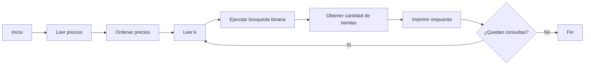

# Comida Interesante

**Autores:** Tourist, Soria

**Link:** [Comida Interesante](https://www.cpcjudge.com/problem/comidainteresante)

**Tiempo límite:** 1.0s

**Memoria límite:** 256M

## Descripción

A cierto Capibara Celestial le gusta descansar después de un duro día de trabajo, así que es común encontrarlo recostado comiendo algo. Como todo Capibara Celestial, adora las $Empanadas$, que se venden en $n$ tiendas diferentes de la ciudad. Se sabe que el precio de una $Empanada$ en la tienda $i$ es de $x_i$ monedas.

El Capibara Celestial planea comprar su comida favorita durante $q$ días consecutivos. Cada día $i$, él sabe que tendrá $m_i$ monedas disponibles. Ahora, para cada día, quiere saber ¿En cuántas tiendas distintas podrá comprar una $Empanada$

## Entrada

- La primera línea contiene un entero $n$ $(1 ≤ n ≤ 10^5)$ el número de tiendas que venden $Empanadas$.
- La segunda línea contiene n enteros $x_i$ $(1 ≤ x_i ≤ 10^9)$ los precios de la comida en cada tienda.
- La tercera línea contiene un entero $q$ $(1 ≤ q ≤ 10^5)$ el número de días que el Capibara Celestial comprará.
- Luego siguen $q$ líneas, cada una con un entero $m_i$ $(1 ≤ m_i ≤ 10^9)$ la cantidad de monedas que tiene el día $i$.

## Salida

Imprime $q$ enteros, uno por día. El $i-ésimo$ entero debe ser igual al número de tiendas donde el Capibara Celestial puede comprar una $Empanada$ en el día $i$.

## Ejemplos

### Ejemplo 1

#### Entrada

```text
5
3 10 8 6 11
4
1
10
3
11
```

#### Salida

```text
0
4
1
5
```

## Notas

- Día 1 $(m_1 = 1)$: No puede comprar en ninguna tienda (todas cuestan más de 3). $→ 0$
- Día 2 $(m_2 = 10)$: Puede comprar en las tiendas con precios $3, 6, 8, 10 → 4$
- Día 3 $(m_3 = 3)$: Solo puede en la tienda con precio $3 → 1$
- Día 4 $(m_4 = 11)$: Puede comprar en todas $3, 6, 8, 10, 11 → 5$

## Temas identificados

### Programación

- Ordenamiento
- Busqueda binaria


### Matemáticas

- Desigualdades
- Conteo

## Propuesta de solución

**Autor de la propuesta:** mae

Ordenar los precios de menor a mayor y utilizar una función de búsqueda binaria para encontrar la primera posición cuyo precio sea mayor que la cantidad de monedas disponibles. Esta posición indica cuántas tiendas permiten comprar una empanada.

## Observaciones

- Los precios deben ordenarse antes de aplicar la búsqueda binaria.
- Se puede comprar una empanada si su precio es menor o igual que las monedas disponibles.
- Las tiendas con precios repetidos se cuentan individualmente.
- La búsqueda binaria encuentra la primera posición cuyo precio supera la cantidad disponible.

## Restricciones

Como $n,q \leq 10^5$, revisar todas las tiendas en cada consulta sería ineficiente. Por ello, se utiliza un arreglo estático de tamaño 100005 y búsqueda binaria. El tipo int es suficiente porque los valores no superan $(10^9)$.

## Estados o estructura de la solución

- $n$: número de tiendas.
- $a$: arreglo de precios ordenados.
- $q$: número de consultas.
- $k$: monedas disponibles.
- $l$, r: límites del intervalo de búsqueda.
- $m$: posición central.
- $pos$: primera posición cuyo precio es mayor que k; si no existe, vale n.

## Casos base

**Ninguna tienda accesible**: si todos los precios superan k, la respuesta es 0.

**Todas las tiendas accesibles**: si ningún precio supera k, la respuesta es n.


## Transiciones o algoritmo

Primero, se leen los precios de las empanadas y se ordenan de menor a mayor. Después, se lee el número de consultas y, para cada una, la cantidad de monedas disponibles $k$. Se aplica la búsqueda binaria calculando la posición central $m$. Si $a[m]$ es mayor que $k$, se guarda esa posición en $pos$ y se continúa buscando a la izquierda, en caso contrario, se busca a la derecha. Finalmente, se imprime $pos$, que representa la cantidad de tiendas donde se puede comprar una empanada.



## Correctitud

El arreglo ordenado coloca primero los precios menores o iguales que k. La búsqueda binaria encuentra la primera posición cuyo precio es mayor que k. Por tanto, esa posición coincide con la cantidad de tiendas donde se puede comprar una empanada. Si no existe un precio mayor, la respuesta es n.


## Implementación
El programa comienza leyendo el número de tiendas y almacenando los precios de las empanadas en el arreglo $a$. Después, utiliza la función `sort()` para ordenar los precios de menor a mayor. Luego, lee el número de consultas y, para cada una, obtiene la cantidad de monedas disponibles $k$ y llama a la función `busquedaBinaria()`. Esta función utiliza las variables $l$ y $r$ para definir los límites de búsqueda, y calcula m como la posición central del intervalo. Si el precio `a[m]` es mayor que $k$, guarda esa posición en $pos$ y continúa buscando a la izquierda; de lo contrario, busca a la derecha. Este proceso se repite hasta encontrar la primera posición cuyo precio sea mayor que la cantidad disponible. Finalmente, devuelve $pos$, que representa el número de tiendas donde se puede comprar una empanada, y el programa imprime el resultado de cada consulta.

### C++

**Autor de la implementación:** mae

```cpp

#include <bits/stdc++.h>

using namespace std;

int a[100005];

int busquedaBinaria(int l, int r, int k);

int main()
{
    cin.tie(0); ios::sync_with_stdio(false);

    int n;
    cin >> n;

    for (int i = 0; i < n; i++){
        cin >> a[i];
    }

    sort(a, a + n);

    int q;
    cin >> q;

    while (q--){
        int k;
        cin >> k;
        cout << busquedaBinaria(0, n - 1, k) << '\n';
    }

    return 0;
}

int busquedaBinaria(int l, int r, int k){
    int m;
    int pos = r + 1;

    while (l <= r){
        m = l + (r - l) / 2;

        if (a[m] > k){
            pos = m;
            r = m - 1;
        } else {
            l = m + 1;
        }
    }

    return pos;
}

```

## Casos límite

- Todas las empanadas cuestan más que el dinero disponible.
- Solo existe una tienda
- Un precio coincide exactamente con las monedas: precios $(3, 5, 8)$, monedas $(5)$. Resultado: $2$.
- Existen precios repetidos: precios $(2, 2, 2, 5)$, monedas $(2)$. Resultado: $3$.
- La cantidad disponible es máxima: cualquier conjunto válido de precios y monedas $(10^9)$. Resultado: 
$n$, ya que ningún precio puede superar $(10^9)$.
- La cantidad disponible es menor que el precio mínimo: precios $(10, 20, 30)$, monedas $(1)$. Resultado: $0$.
