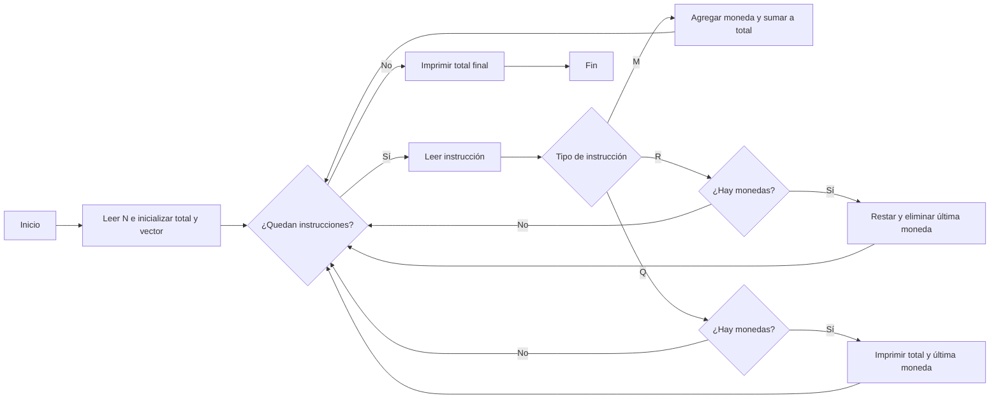

# La alcancía de Mayin

**Autor:** Tourist

**Link:** [La alcancía de Mayin](https://www.cpcjudge.com/problem/alcanciamayin)

**Tiempo límite:** 1.0s

**Memoria límite:** 256M

## Descripción

El día de hoy como es de costumbre tu, regresando de la escuela te habla tu hermanito  **Mayin** el cual en busca de convivir y aprender algo nuevo contigo te pide ayuda para saber cuanto ha estado ahorrando en su alcancía cilíndrica, el te explica que lleva un registro de como ha manejado sus ahorros, sin embargo no es muy bueno haciendo cuentas así que te pide ayuda. Su registro se presenta de la siguiente manera:

Se te dará una instrucción $T$, la cual denota una acción:
- Si la instrucción que recibes es `M`, se te dará un número $K$ que significa que Mayin puso una moneda de esa cantidad en la parte superior de su alcancía.
- Si la instrucción que recibes es `Q`, significa que Mayin quiere saber cuanto lleva en ese momento ahorrado y cual fue la última moneda que puso en su alcancía. Solo imprimiras si **tiene** al menos una moneda en su alcancía, de lo contrario no imprimirás nada.
- Si la instruccion que recibes es $R$, significa que Mayin quito la última moneda que puso en la parte superior, si es que esta tiene.

## Entrada

En la primera linea, un número entero $N$ $(1 \leq N \leq 10^5)$, la cantidad de instrucciones que te dará Mayin.

Las siguientes $N$ líneas contendrán instrucciones tipo $T$. Si alguna de las instrucciones lo requiere entonces recibirás un numero $K$ $(1 \leq K \leq 10^4)$ siendo esta la moneda que ingresó Mayin.

## Salida

Al final del registro, deberás imprimir con cuánto dinero terminó la alcancía de Mayin después de todos los movimientos que realizó. En caso de no tener monedas imprime **$0$**.

## Ejemplos

### Ejemplo 1

#### Entrada

```text
10
M 25
M 38
M 27
Q
R
Q
M 42
M 6
Q
R
```

#### Salida

```text
90 27
63 38
111 6
105
```


## Temas identificados

### Programación

- Pilas
- Vectores

### Matemáticas

- Suma y resta de enteros

## Propuesta de solución

**Autor de la propuesta:** mae

El problema se puede resolver simulando las operaciones que realiza Mayin sobre su alcancía mediante un vector que funciona como una pila. Cada moneda agregada se almacena al final del vector y se suma su valor a una variable que mantiene el dinero total.

Cuando se recibe una instrucción $R$, si la pila no está vacía, se resta del total el valor de la última moneda y se elimina dicha moneda. Para una instrucción $Q$, si hay monedas, se imprime el total acumulado y el valor de la moneda ubicada al final de la pila.

Finalmente, se imprime el dinero total restante. Esta estrategia evita recalcular la suma de todas las monedas después de cada operación.

## Observaciones

- Las monedas se retiran en orden inverso al que fueron agregadas.
- Las instrucciones $R$ y $Q$ no modifican la alcancía cuando está vacía.
- La variable $total$ mantiene actualizada la suma de las monedas almacenadas.

## Restricciones

Dado que $N \le 10^5$, se requiere un procesamiento eficiente para cada instrucción. Usar un vector como pila permite agregar, consultar y remover la última moneda en tiempo constante $O(1)$ por operación. Como el dinero acumulado no superará los $10^9$ ($10^5 \times 10^4$), el tipo de dato int es suficiente para almacenar el total.

## Estados o estructura de la solución
- monedas: vector que almacena los valores de las monedas en el orden en que fueron agregadas. El último elemento representa la moneda que se retiraría primero.
- total: variable que contiene la suma de todas las monedas que permanecen en la alcancía.
- t: número de instrucciones que se procesarán.
- in: carácter que identifica la instrucción actual.
- k: valor de la moneda que se agrega cuando la instrucción es M.

## Casos base

- Alcancía vacía: inicialmente, el vector está vacío y total = 0.
- Retirar sin monedas: si llega una instrucción R con el vector vacío, no se realiza ninguna operación.
- Consultar sin monedas: si llega una instrucción Q con el vector vacío, no se imprime información.
- Agregar la primera moneda: se almacena su valor y se actualiza total.

## Transiciones o algoritmo
- Leer el número de instrucciones $(N)$.
- Inicializar un vector vacío y establecer $total$ = $0$.
- Procesar cada instrucción:
     - Si es $M$, leer $(K)$, agregarlo al vector y sumarlo a total.
     - Si es $R$ y el vector no está vacío, restar la última moneda de total y eliminarla del vector.
     - Si es $Q$ y el vector no está vacío, imprimir total y el valor de la última moneda.
- Al terminar las instrucciones, imprimir total.



## Correctitud

El vector almacena las monedas en el orden en que se agregan, permitiendo retirar siempre la última. La variable total se actualiza al agregar o retirar monedas, por lo que representa correctamente el dinero acumulado. Las consultas muestran el total y la última moneda solo cuando la alcancía no está vacía.

## Complejidad computacional

- Tiempo: $O(N)$
- Memoria: $O(N)$

## Implementación

### C++

**Autor de la implementación:** mae

```cpp
#include <bits/stdc++.h>

using namespace std;

int main()
{
    cin.tie(0); ios_base::sync_with_stdio(false);

    vector<int> monedas;
    int t;
    cin >> t;

    int total = 0;
    char in;

    for (int i = 0; i < t; i++){
        cin >> in;
        int k;
        if (in == 'M'){
        cin >> k;
            monedas.push_back(k);
            total += k;

        } else if ( in == 'R' && !monedas.empty()){
            monedas.back();
            total -= monedas.back();
            monedas.pop_back();

        } else if (in == 'Q' && !monedas.empty()){
            cout << total << " " << monedas.back() << '\n' ;
        }
    }
    cout << total;
}
```
**Autor de la implementación:** mae

```cpp
#include <bits/stdc++.h>

using namespace std;

int main()
{
    cin.tie(0);
    ios_base::sync_with_stdio(false);

    list<int> monedas;
    int t;
    cin >> t;

    int total = 0;
    char in;

    for (int i = 0; i < t; i++) {
        cin >> in;

        int k;

        if (in == 'M') {
            cin >> k;
            monedas.push_back(k);
            total += k;

        } else if (in == 'R' && !monedas.empty()) {
            total -= monedas.back();
            monedas.pop_back();

        } else if (in == 'Q' && !monedas.empty()) {
            cout << total << " " << monedas.back() << '\n';
        }
    }

    cout << total << '\n';

    return 0;
}
```

## Casos límite

- Alcancía vacía: si se intenta retirar o consultar, no se realiza ninguna operación. El total final es $0$.
- Una sola moneda: al agregar una moneda de valor $10$, el total es $10$; si se retira, vuelve a $0$.
- Máximo de instrucciones: con $(N = 10^5)$, el algoritmo procesa todas las operaciones en tiempo lineal.
- Máximo ahorro: si se agregan $(10^5)$ monedas de valor $(10^4)$, el total es $(10^9)$, que cabe en un int.
